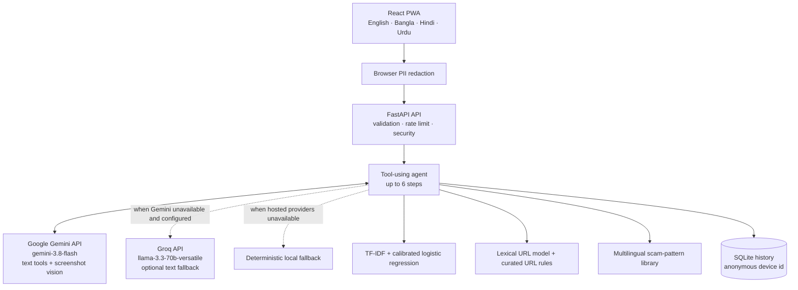

# ScamLens


**Spot the scam. Understand why. Know what to do next.**

ScamLens is a multilingual digital-safety app for people in Bangladesh and across South Asia. It checks suspicious messages and links, explains the warning signs in plain language, and suggests safe next steps. The interface supports **English, Bangla (বাংলা), Hindi (हिन्दी), and Urdu (اردو)**.

**Live product:** [scamlens-api.onrender.com](https://scamlens-api.onrender.com/) · [API health](https://scamlens-api.onrender.com/api/health)

---

## Problem statement

People across South Asia receive deceptive messages and links impersonating mobile-money providers, banks, delivery companies, employers, and authorities. Older adults and first-time smartphone users may not recognize fake-KYC, OTP, urgency, or payment tactics. Generic spam tools often provide only a label, without explaining which words or links are suspicious, what action to take, or how to avoid similar scams—especially when a message is written in Bangla, Hindi, or Urdu.

## Proposed solution

ScamLens accepts pasted text and URLs, and also supports screenshots and voice transcripts. It combines local machine-learning models, link analysis, and a curated scam-pattern library with optional hosted AI assistance. The user receives a SAFE / SUSPICIOUS / SCAM verdict, a risk score, highlighted warning signs, practical next steps, and—when available—a complaint draft, a family warning, and a short learning activity. If hosted AI is unavailable, ScamLens uses a deterministic local fallback and tells the user that it is in degraded mode.

## Key features

- **Explainable results:** risk verdict and score, highlighted message spans, and plain-language reasons.
- **Multiple input types:** text, URL, screenshot, and on-device voice transcript.
- **Actionable guidance:** ordered safety steps, complaint draft, and a forwardable family alert.
- **Digital-literacy learning:** short lessons, quizzes, and a local Scam IQ score.
- **Four languages:** English, Bangla, Hindi, and Urdu.
- **Resilient operation:** local classifiers and curated rules remain available when a hosted AI provider is missing, rate-limited, or unavailable.

---

## AI methodology and implementation

1. **Privacy-aware input handling.** Typed text is redacted in the browser and re-checked on the server before it is sent to a hosted AI provider. Screenshot images are sent to Gemini Vision as uploaded and may contain personal information; crop or blur sensitive areas before uploading.
2. **Local evidence.** ScamLens computes signals using a TF-IDF text classifier, a lexical URL model and URL rules, and a multilingual curated scam-pattern library.
3. **Optional AI agent.** Gemini is the primary tool-calling provider. The agent can use up to six steps and eight tools to classify text, examine URLs safely, match scam patterns, and draft localized explanations or safety content. Groq is an optional fallback for supported text requests when Gemini is rate-limited; screenshot vision requires Gemini.
4. **Calibrated decision.** The final risk verdict is based on a calibrated ensemble of local signals and, when available, the model's judgement. It is not a free-form LLM answer alone.
5. **Honest fallback.** If the hosted providers cannot answer, the deterministic local agent returns a result and the UI indicates degraded/offline mode rather than pretending hosted AI succeeded.



### Hosted AI models and APIs

| Provider / model | Use in ScamLens | Limitations / disclosure |
|---|---|---|
| **Google Gemini Developer API — `gemini-3.8-flash`** | Primary agent provider; tool calling, localized content, and screenshot OCR/vision | API key is server-side (`GEMINI_API_KEY`). Free-tier quotas can be exhausted; Google’s free-tier data-use terms may apply. |
| **Groq API — `llama-3.3-70b-versatile`** | Optional fallback for supported text requests when Gemini is rate-limited or unavailable | API key is server-side (`GROQ_API_KEY`). It does not provide the screenshot-vision fallback in this deployment. |
| **AI coding assistant** | Assisted during development | The code was reviewed and tested by the solo participant. |

The Gemini API is optional. Do not send confidential information. Typed text PII is redacted before the hosted model call; screenshot images are not automatically blurred, so crop or blur them first. Review Google’s [current Gemini API pricing and data-use terms](https://ai.google.dev/gemini-api/docs/pricing).

---

## Technology stack

| Layer | Technologies |
|---|---|
| Frontend | React, TypeScript, Vite, Tailwind CSS, Progressive Web App (PWA) |
| Backend | Python 3.12, FastAPI, Pydantic |
| Local ML | scikit-learn, TF-IDF, calibrated logistic regression, lexical URL features, curated rules |
| Hosted AI | Google Gemini API; optional Groq text fallback |
| Storage | SQLite and browser local storage for device preferences / learning progress |
| Deployment | Docker, Render |
| Testing | pytest, Vitest, TypeScript typecheck, production frontend build |
| Browser speech features | Web Speech API for voice input and SpeechSynthesis for read-aloud |

---

## Measured results

The metrics below are produced by the project’s evaluation scripts and stored in `ml/artifacts/metrics.json` and related artifacts. The LLM-only result is deliberately not reported until it is measured; no number is invented for that cell.

| Model / pipeline | Test split | Precision | Recall | F1 | ROC AUC |
|---|---:|---:|---:|---:|---:|
| Text classifier (TF-IDF + calibrated logistic regression) | 1,252 messages | 0.955 | 0.985 | **0.969** | 0.998 |
| Optional multilingual MiniLM + calibrated logistic regression | Same split | 0.939 | 0.876 | 0.906 | 0.994 |
| **Shipped text pipeline, end to end** | Same split | 0.989 | 0.943 | **0.966** | 0.984 |
| Curated URL rule layer | 42 held-out local URLs | — | — | **100% correct (42/42)** | — |
| PhiUSIIL-trained URL model (research comparison) | 9,000 URLs | 0.991 | 0.985 | 0.988 | 0.997 |
| Optional XGBoost URL comparison | Same URL split | 0.999 | 0.991 | 0.995 | 0.998 |
| Gemini-only LLM benchmark | Not evaluated | — | — | — | — |

The PhiUSIIL-trained URL model is not authoritative for URL decisions. It can incorrectly flag legitimate official domains, so the transparent curated URL-rule layer makes the deployed URL decision. See [ML methodology](docs/ML_METHODOLOGY.md) for evaluation details, thresholds, and limitations.

The text test set is English-heavy. Bangla, Hindi, and Urdu training data is smaller, so results for those languages should be treated cautiously. The app is decision support, not a guarantee that a message is safe.

---

## Screenshots

Screenshots of the running interface at a 390×844 phone viewport:

| | | |
|---|---|---|
|  |  |  |
|  |  |  |
|  |  |  |
|  |  | |

---

## Setup and installation

### Requirements

- Python 3.12
- Node.js 20 or later and npm
- Git
- Optional: Docker for the one-container production setup

### Local development (macOS / Linux / Git Bash)

```bash
git clone https://github.com/rafiul254/ScamLens.git
cd ScamLens
cp .env.example .env       # optional; leave keys empty to use the local fallback
make setup
make dev
```

Open **http://localhost:5173**. The API is available at **http://localhost:8000/docs**.

### Local development (Windows PowerShell)

From the project root, create and activate a virtual environment, then install the backend dependencies:

```powershell
py -3.12 -m venv .venv
.\.venv\Scripts\Activate.ps1
Copy-Item .env.example .env
python -m pip install -r backend/requirements.txt
```

In a first terminal, start the backend from the project root:

```powershell
python -m uvicorn app.main:app --reload --app-dir backend --host 127.0.0.1 --port 8000
```

In a second terminal:

```powershell
cd frontend
npm ci
npm run dev -- --host 127.0.0.1 --port 5173
```

Open **http://localhost:5173**. To use hosted AI locally, add `GEMINI_API_KEY` and, optionally, `GROQ_API_KEY` to the root `.env` file. Never commit `.env` or place provider keys in frontend variables. Keys are optional; the local fallback works without them.

### Docker

```bash
docker compose up --build
```

The frontend and API are served from **http://localhost:8000**. The hosted API keys are optional.

### Optional model training

Pre-built model artifacts are used for normal app startup. To reproduce the data pipeline and retrain, run `make data` and `make train`; this downloads external datasets and is not required for the usual local or Render deployment.

### Tests

```bash
make test
```

The current recorded suite has **141 backend tests + 16 frontend tests = 157 tests**. TypeScript typechecking and the production frontend build also pass.

---

## API overview

Interactive API documentation is available at `/docs` on the deployed API.

| Method | Endpoint | Purpose |
|---|---|---|
| `GET` | `/api/health` | Service, agent, and model status |
| `POST` | `/api/analyze/text` | Analyze a message in a supported language |
| `POST` | `/api/analyze/url` | Analyze a URL using lexical signals and curated rules |
| `POST` | `/api/analyze/image` | Screenshot analysis using Gemini Vision when available |
| `POST` | `/api/analyze/audio` | Analyze an on-device voice transcript |
| `POST` | `/api/redact` | Preview PII redaction |
| `GET` | `/api/learn/patterns` | List scam-pattern playbooks |
| `GET` | `/api/learn/lesson` | Get a localized micro-lesson and quiz |
| `POST` | `/api/learn/quiz` | Submit quiz answers and update Scam IQ |
| `GET` | `/api/benchmark` | Read measured benchmark data |
| `GET` | `/api/samples` | Get demo samples |
| `GET` / `DELETE` | `/api/history`, `/api/data` | Read or delete device-associated scan history |

More detail: [API reference](docs/API.md) · [ML methodology](docs/ML_METHODOLOGY.md) · [Data sources and licenses](data/README.md).

---

## Privacy, safety, and limitations

- No account is required. Scan history is associated with an anonymous device identifier and can be deleted.
- Typed text is redacted in the browser and again on the server before it reaches a hosted AI provider. Screenshot images are sent to Gemini as uploaded and may still show personal information; crop or blur them first.
- Google free-tier prompts or images may be subject to Google’s current data-use terms. Do not submit confidential or highly sensitive content.
- Submitted links are not rendered or executed. URL checks use lexical features and, when enabled, a guarded HEAD-only probe.
- Novel scam wording, image-only scams, and phone calls may evade detection. A low score is not proof of safety. Bangla, Hindi, and Urdu training data is smaller than English.
- If Gemini is quota-limited, screenshot OCR may be unavailable. Groq is not a screenshot-vision fallback. ScamLens should show degraded mode and use local analysis where possible.
- ScamLens is decision support: it does not move money, reply to a sender, or claim certainty.

---

## Team contributions

| Name | Role | Contribution |
|---|---|---|
| **Rafiul Islam** | **Solo participant / Team lead** | Project concept and design; React PWA; FastAPI backend and agent integration; ML and URL-risk pipeline; provider integration; testing, deployment, and documentation. |

## License and acknowledgements

Original project code is released under the [MIT License](LICENSE). Third-party datasets retain their own licenses and terms; see [`data/README.md`](data/README.md) and the dataset cards. Hosted AI services used by the project are disclosed above. Libraries include FastAPI, React, Vite, Tailwind CSS, scikit-learn, sentence-transformers, and RapidFuzz.
