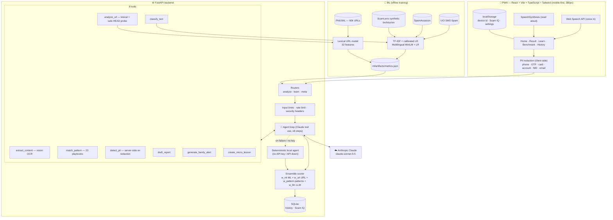
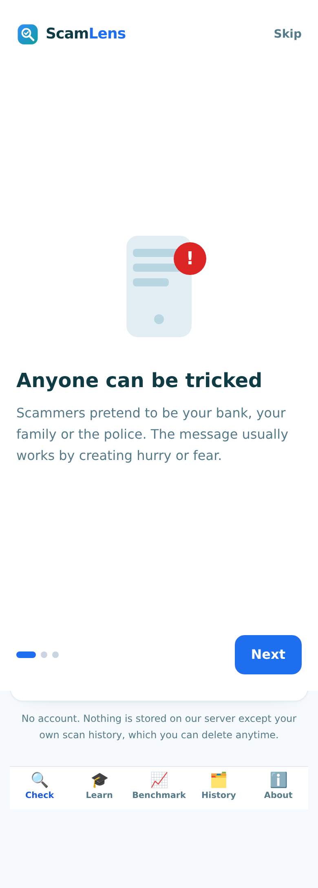
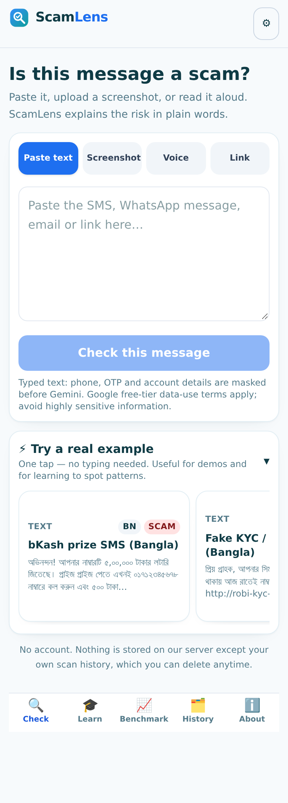
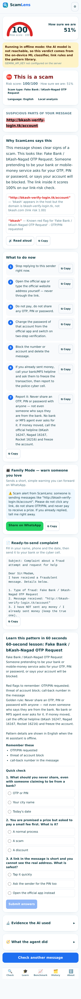
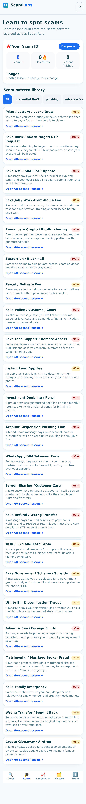
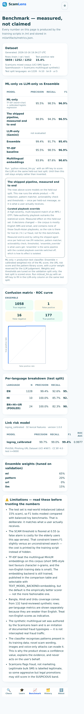
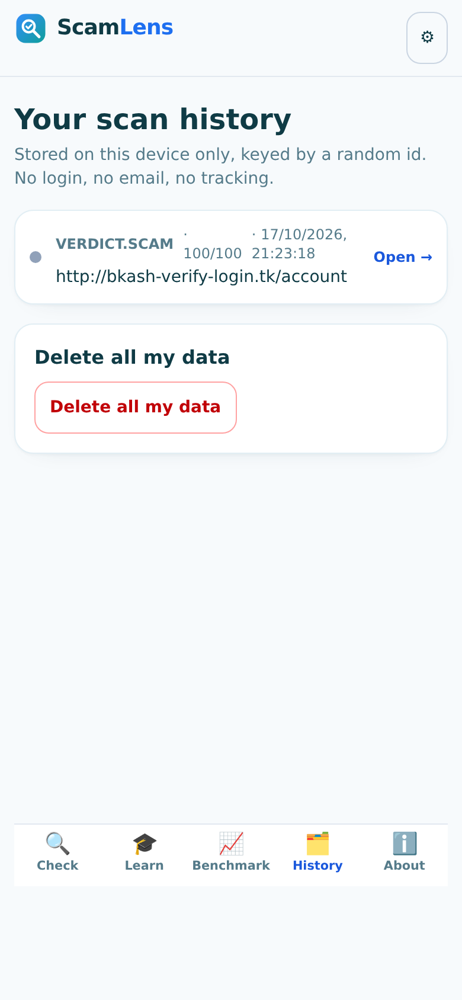
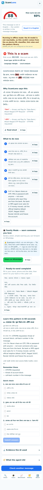
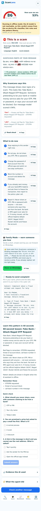
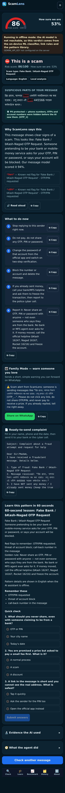

# ScamLens


**An AI agent that checks a suspicious message, explains why it is dangerous in plain
language, helps you act — and then teaches you the pattern.**

Built for the **NYLP AI Hackathon 2026** (theme: *Building AI-Powered Products*, part of
the Global Summit on Digital Literacy & Leadership).

Target users: elderly and less tech-savvy people in South Asia, plus students.
Languages: **বাংলা (bn) · English (en) · हिन्दी (hi) · اردو (ur)** — detected automatically.

---

## The problem

Mobile-money fraud is the fastest-growing crime against people who have only recently
got online. A fake bKash/Nagad SMS, a "your KYC expires tonight" threat, a "digital
arrest" call, a work-from-home fee, a parcel stuck at customs. Existing anti-spam tools
answer *spam / not spam*, in English, and stop there. The person who needs help is
often 60, reads Bangla, and does not know what an OTP is — so the same household gets
robbed twice: once by the scammer, once by not understanding what happened.

## The solution

One screen. Paste a message, upload a screenshot, speak it, or paste a link. ScamLens
returns:

* a **verdict** (SAFE / SUSPICIOUS / SCAM) with a **risk score** and a confidence value,
* **the exact words in the message that are dangerous**, highlighted with intensity
  proportional to their real weight, each with a plain-language reason,
* **"what to do now"** — ordered steps, one tap to copy each,
* a **ready-to-send complaint** for the bank, MFS provider or cyber cell,
* **Family Mode** — a short warning you can forward to elderly relatives on WhatsApp,
* a **60-second micro-lesson with a 3-question quiz** in your language, feeding a local
  **Scam IQ** score with streaks and badges.

And it does all of that **without ever seeing your private data**: phone numbers, OTPs,
card and account numbers are redacted in the browser *and* on the server before any text
reaches the AI.

---

## Architecture



**Why the ensemble decides the verdict, not the model.** The final risk score is a
calibrated weighted mix of the ML classifier, the link-risk model and the pattern
library, with a published weight for the agent's own judgement. A cleverly-worded
message cannot talk ScamLens into "SAFE", and any disagreement between the agent and
the ensemble is shown to the user in the Evidence panel.

---

## Measured results (not claimed results)

Every number below is produced by the training scripts and stored in
`ml/artifacts/metrics.json`. The Benchmark tab reads that file over HTTP — **no metric
is typed into the frontend.**

| Model | Test split | Precision | Recall | F1 | ROC AUC |
|---|---|---|---|---|---|
| Text classifier (TF-IDF + calibrated LR) — **ML-only** | 1,252 real-world rows | 0.955 | 0.985 | **0.969** | 0.998 |
| Text classifier (multilingual MiniLM + calibrated LR) | same | 0.939 | 0.876 | 0.906 | 0.994 |
| **Shipped pipeline, scored end to end** (PII redaction + classifier + link rules + actionability + thresholds) | same | 0.989 | 0.943 | **0.966** | 0.984 |
| Link rule layer (curated, decides URL risk) | 42 held-out local URLs | — | — | **100%** correct (42/42) | — |
| Link model (PhiUSIIL-trained, research only — see below) | 9,000 held-out URLs | 0.991 | 0.985 | **0.988** | 0.997 |
| Link model (xgboost, optional dependency) | same | 0.999 | 0.991 | 0.995 | 0.998 |
| LLM-only (Claude, zero-shot) | same 1,252 rows | *not evaluated* | | | |

**The row that matters most is "shipped pipeline"**: it calls the real agent once per
held-out row (`ml/eval_ensemble.py`), so it is what a user actually receives, weights,
thresholds, actionability check and all.

**Two URL numbers, on purpose.** The PhiUSIIL-trained model scores well on PhiUSIIL's global
URL population but, measured on the held-out local sanity set of official-domain pages and
brand look-alikes that our users actually meet (`ml/url_sanity_set.py`), the deployable
candidates false-alarmed on 12 and 10 official domains respectively while still
missing look-alikes. So the bundle ships with `"authoritative": false`, its scores are
reported for research, and the transparent curated rule layer decides URL risk — where it
scores **100%** with 0 false alarms and 0 missed look-alikes. Replacing a rule that
is right with a model that is confidently wrong is not progress, so the gate
(`ml/train_url_model.py`) refuses to promote a model that fails it.

The curated playbook override (a high-severity MFS/OTP/fake-authority match outranks the
statistical score) changed **0** decisions on this held-out set: the corpus is mostly
English SMS and email and contains none of those South-Asian playbooks. Its measured effect
is reported rather than assumed, and it is what the Bangla/Hindi/Urdu demo messages exercise.

The LLM-only cell stays **empty on purpose** until someone runs
`python ml/eval_llm.py` with an API key. We would rather show a blank cell than a
fabricated number. The Benchmark page says exactly that.

Full methodology, including why TF-IDF beat the embedding model (and how to switch),
the constrained decision threshold that trades a little F1 for far fewer false alarms,
and the honest limitations → **[`docs/ML_METHODOLOGY.md`](docs/ML_METHODOLOGY.md)**.

Data provenance: UCI SMS Spam Collection, SpamAssassin public corpus, PhiUSIIL
Phishing URL Dataset (UCI #967, CC BY 4.0), plus **224 hand-reviewed synthetic
Bangla/Hindi/Urdu/English scam and legitimate messages** written by the team
(151 scam / 73 legitimate) → **[`data/README.md`](data/README.md)**.

---

## Screenshots

Real captures of the running app at a 390×844 phone viewport (`node frontend/scripts/screenshots.mjs`)
— no mock-ups. English is the default interface; screenshots 9–10 show a Bangla message being
read back in English with one tap.

| | | |
|---|---|---|
|  |  |  |
|  |  |  |
|  |  |  |
|  |  | |

---

## How ScamLens uses AI

Disclosed as the hackathon's AI-usage policy requires.

| Where | What | Notes |
|---|---|---|
| **Anthropic Claude** (`claude-sonnet-5-5`) | the agent loop (tool use, ≤ 6 steps), vision OCR for screenshots, in-language lesson/report/family-alert writing | key read from `ANTHROPIC_API_KEY`, server-side only; **optional** |
| **scikit-learn** | TF-IDF + calibrated logistic regression text classifier; calibrated logistic regression link model; ensemble tuning | trained by us on real corpora |
| **sentence-transformers** (paraphrase-multilingual-MiniLM-L12-v2) | second text backend (trained, benchmarked, selectable with `TEXT_MODEL_BACKEND=embedding`) | optional dependency |
| **Curated pattern library** | 23 documented scam typologies with red flags, psychology and safe responses, keyword-matched in 4 languages | hand-written, no model needed |
| **Browser APIs** | Web Speech API (voice in), SpeechSynthesis (read aloud) | on-device |
| **AI used to write this code** | an AI coding assistant was used as a development tool; every line was reviewed, run and tested by the team | per hackathon rule 10 |

**Without an API key ScamLens still works.** It runs the deterministic local agent
(ML classifier + URL model + pattern library + localised templates) and shows an amber
"offline mode" banner in the UI, so a demo never silently changes behaviour.

Gemini is the primary model. If Gemini is rate-limited (`429 RESOURCE_EXHAUSTED`),
ScamLens automatically retries the same request on Groq when `GROQ_API_KEY` is set
(`GROQ_MODEL` defaults to `llama-3.3-70b-versatile`). Only when both providers fail
does the UI fall back to offline mode.

---

## Quick start

### One command (the way we run it)

```bash
git clone <your-repo-url> && cd ScamLens
cp .env.example .env          # optional: put your ANTHROPIC_API_KEY in here
make setup                    # backend + frontend dependencies
make train                    # optional: rebuild the datasets and retrain both models
make dev                      # → API on :8000, PWA on :5173
```

Open **http://localhost:5173**. Works best in a phone-sized window.

`make dev` needs no API key. Add one to `.env` if you want the full Claude agent
(vision OCR, drafted complaints and lessons written by the model).

### Docker

```bash
docker compose up --build      # API + built PWA on http://localhost:8000
```

### Tests

```bash
make test        # 83 backend pytest + 16 frontend vitest
```

Backend coverage: URL analyzer (brand impersonation, SSRF guard, scoring bounds),
PII redaction (4 scripts, Luhn card check, round-trip restore), the strict result
schema, the pattern library in all four languages, the ensemble maths and a full
API walk-through. Frontend: client PII redaction, input tabs, highlight rendering,
risk gauge accessibility and i18n fallbacks.

---

## API

| Method | Path | Purpose |
|---|---|---|
| `GET` | `/api/health` | real model/agent state (used by the About page) |
| `POST` | `/api/analyze/text` | analyse a message (4 languages, auto-detected) |
| `POST` | `/api/analyze/url` | analyse a link (lexical + optional safe HEAD probe) |
| `POST` | `/api/analyze/image` | screenshot → Claude vision OCR → analysis |
| `POST` | `/api/analyze/audio` | voice-note transcript → analysis |
| `POST` | `/api/redact` | PII detection/redaction preview |
| `GET` | `/api/learn/patterns` | the 23-pattern library |
| `GET` | `/api/learn/lesson` | 60-second lesson + quiz for a pattern |
| `POST` | `/api/learn/quiz` | submit a quiz → Scam IQ update |
| `GET` | `/api/learn/scamiq` | Scam IQ, streak, badges |
| `GET` | `/api/benchmark` | real metrics from `metrics.json` |
| `GET` | `/api/samples` | Demo Mode samples |
| `GET` | `/api/history` · `DELETE /api/data` | local history · wipe everything |

Interactive docs: **http://localhost:8000/docs**. Request/response examples →
[`docs/API.md`](docs/API.md).

The response contract (validated by Pydantic on every request):

```json
{
  "verdict": "SCAM",
  "risk_score": 92,
  "confidence": 0.88,
  "language": "bn",
  "scam_type": "fake_otp_mfs",
  "red_flags": [{"text_span": "ওটিপি দিন", "reason": "Banks never ask for an OTP", "severity": 0.95}],
  "explanation": "…in the user's language, 6th-grade level…",
  "recommended_actions": ["…ordered steps…"],
  "report_draft": "…", "family_alert": "…", "lesson": { "…": "…" },
  "evidence": {
    "ml_score": 0.93, "url_score": 0.87, "pattern_score": 0.81, "llm_score": 0.9,
    "ensemble_breakdown": {"effective_weights": {"ml": 0.4, "url": 0.35, "pattern": 0.1, "llm": 0.15}},
    "agent_steps": [{"step": 1, "tool": "detect_pii", "source": "agent_call", "duration_ms": 4}]
  },
  "pii_redacted": true,
  "mode": "agent"
}
```

---

## Repository layout

```
ScamLens/
├── backend/                 FastAPI app
│   ├── app/
│   │   ├── main.py          app, CORS, security headers, SPA serving
│   │   ├── schemas.py       the strict Pydantic contract
│   │   ├── security.py      rate limiting, input guards
│   │   ├── routers/         analyze · learn · meta
│   │   ├── services/        agent · llm · ml_classifier · url_analyzer · patterns ·
│   │   │                    pii · ensemble · i18n · db
│   │   └── data/scam_patterns.json   the 23-pattern library (4 languages)
│   └── tests/               83 pytest tests
├── frontend/                React + Vite + TS + Tailwind PWA
│   └── src/{pages,components,lib,tests}
├── ml/                      dataset builders, trainers, evaluation
│   ├── build_text_dataset.py · train_text_model.py
│   ├── build_url_dataset.py  · train_url_model.py
│   ├── eval_llm.py           optional LLM-only benchmark column
│   └── artifacts/            models + metrics.json (generated)
├── data/                    dataset cards, provenance, demo samples
├── docs/                    methodology · URL rules · API · ethics · demo script
├── Dockerfile · docker-compose.yml · Makefile · .env.example
```

---

## Features at a glance

**Input** — four tabs (paste / screenshot with drag-and-drop and paste-from-clipboard /
voice / link), language auto-detected from the script (Bangla, Devanagari, Arabic-script,
Latin with romanised-Banglish detection).

**Languages** — the interface opens in **English by default** (a reviewer should not have to
guess which language they landed in) and switches between English, বাংলা, हिन्दी and اردو in
Settings. Message text is always analysed in its own language, and because a Bangla message
comes back with a Bangla verdict, the result screen offers a one-tap *"Read it in English"*
that re-runs the same message and returns the explanation, actions, report and lesson in the
reader's interface language.

**Result** — animated risk gauge, semantic verdict banner (green/amber/red used *only*
for verdicts), the message with highlighted red flags, "why" in plain language, a
numbered action checklist with copy buttons, read-aloud in the detected language,
Family Mode with a `wa.me` share link, the complaint draft, the micro-lesson and quiz,
plus an Evidence panel and a real agent trace.

**Learn** — 23 pattern cards filterable by category, 60-second lessons with quizzes,
Scam IQ with levels, streaks and badges stored locally.

**Benchmark** — precision/recall/F1/ROC AUC, ROC curve, confusion matrix, the
ML-only vs LLM-only vs Ensemble comparison table, per-language breakdown, the URL model
table, the tuned ensemble weights, and a Limitations section.

**History & privacy** — every scan cached locally, reopenable, and deletable in one
tap along with all Scam IQ progress.

**Accessibility** — large-text mode, high contrast, dark mode, keyboard navigation,
ARIA roles and labels on the gauge, tabs and toggles, 44 px minimum tap targets,
reduced-motion support, and icons that are decorative-only (never the sole carrier of
meaning).

**Robustness** — loading skeletons, error and offline states, rate limiting, input
size limits, and the degraded-mode banner when the LLM is unreachable.

---

## Limitations (short version)

The full, honest list is on the Benchmark page and in
[`docs/ML_METHODOLOGY.md`](docs/ML_METHODOLOGY.md). The short version:

* Novel wording, image-only scams and phone calls can evade detection. A low score is
  **not** a guarantee of safety.
* Bangla, Hindi and Urdu training data is small, so those scores are weaker than English.
  Per-language numbers are published with their sample sizes.
* Screenshot reading requires the vision model; without an API key the app says so
  instead of guessing.
* ScamLens flags fraud, not marketing — an aggressive but legal promotion can still land
  in the SUSPICIOUS band.
* The app is decision support. It never moves money, never replies to the scammer, and
  never claims certainty.

---

## Ethics, privacy and security

Summarised below; the full policy statement is included in the hackathon submission
(`docs/SUBMISSION.md`):

* PII is redacted in the browser **and** on the server before any model call; the model
  works on `[PHONE_1]`-style placeholders. The user's own values are restored only in
  the draft shown back to them.
* No accounts, no tracking, no third-party analytics; one-tap deletion of everything.
* Submitted links are never rendered or executed — only an optional HEAD probe with a
  3-second timeout, SSRF-guarded against private addresses.
* No secrets in the frontend; CORS is enumerated; input limits and rate limiting on
  every analysing endpoint.

---

## Team contributions


| Name | Role | What they built |
|---|---|---|
| _Rafiul Islam_ | Team lead, ML engineer | agent loop, ML pipeline + training, ensemble, benchmark |
| — | Frontend developer | PWA, result screen, Learn tab, accessibility |
| — | Backend developer | FastAPI, SQLite, tests, Docker |
| — | UI/UX designer | onboarding, design system, demo samples |
| — | Researcher / presenter | pattern library, demo video, submission |

---

## Licence and acknowledgements

Code: MIT. Datasets keep their own licences (CC BY 4.0 / public domain) — see
`data/README.md` and the dataset cards. Third-party services: Anthropic Claude API
(optional). Built with FastAPI, React, Vite, Tailwind CSS, scikit-learn,
sentence-transformers, RapidFuzz.
